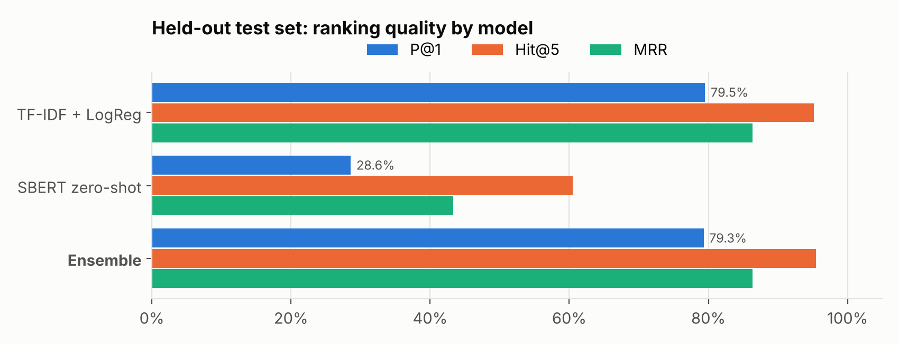
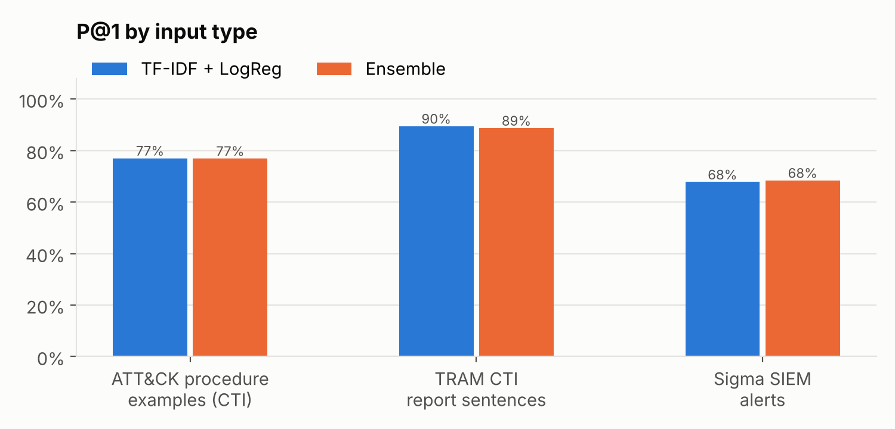
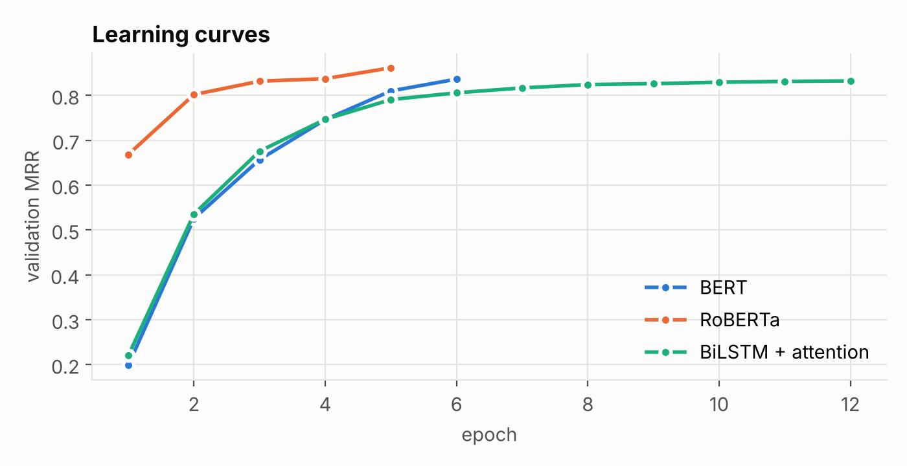
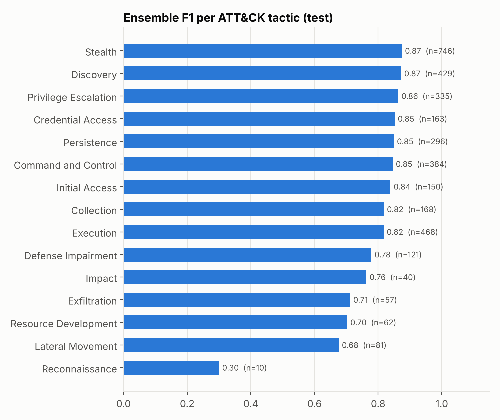
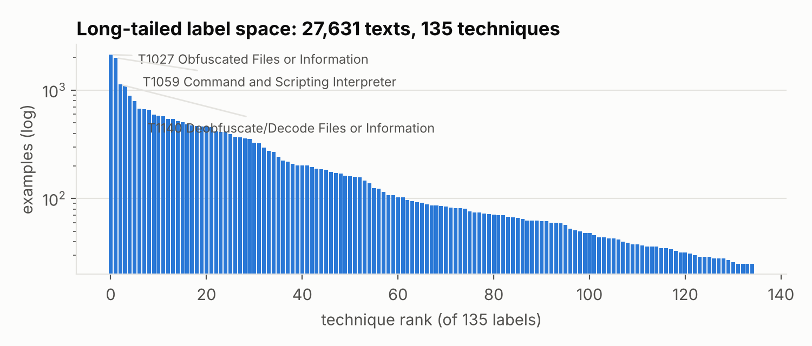
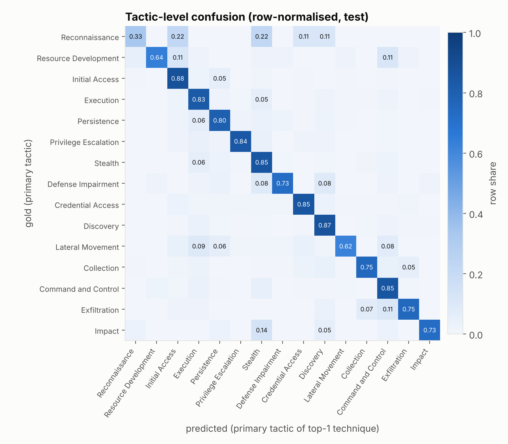

# Automatic Mapping of Security Alerts to MITRE ATT&CK

> **Projet 12 — Cartographie automatique des alertes vers MITRE ATT&CK**
> *Application et supervision* · Associer des journaux ou rapports de sécurité à des tactiques et techniques ATT&CK
> Models: **BERT, RoBERTa, Sentence-Transformer, BiLSTM** (+ TF-IDF baseline and a tuned ensemble)
> Data: **CTI reports, SIEM alerts and ATT&CK technique descriptions**

`attackmap` reads a SIEM alert, EDR detection, log line or threat-intelligence report and returns a
**ranked list of ATT&CK techniques**, the **tactics** (kill-chain stages) they belong to, likely
**sub-techniques**, the **evidence** behind the decision and the **IOCs** in the text. Results can be
exported as an **ATT&CK Navigator layer**. It ships as a Python library, a REST API and a web console.

<p align="center"></p>

---

## Contents
1. [Results](#1-results)
2. [Data](#2-data)
3. [Models](#3-models)
4. [Inference pipeline](#4-inference-pipeline)
5. [Quick start](#5-quick-start)
6. [API](#6-api)
7. [Testing](#7-testing)
8. [Project layout](#8-project-layout)
9. [Limitations & future work](#9-limitations--future-work)

---

## 1. Results

Held-out **test set** (2,731 texts, 135 techniques, never used for training, model selection or
threshold tuning). Full numbers in [`reports/results.json`](reports/results.json).

<!-- RESULTS_TABLE -->

**Metrics.** An analyst reads a ranked list, so ranking metrics lead.
**P@1**: the top technique is correct. **Hit@k**: a correct technique is in the top-k.
**MRR**: mean reciprocal rank of the first correct technique.
**micro / macro F1**: of the predicted *set* (top-1 plus every technique above a threshold tuned on
validation). **Tactic@1**: the top technique shares a tactic with the gold labels.

<!-- CHALLENGE -->

| | |
|---|---|
|  |  |
|  |  |

<p align="center"></p>

## 2. Data

Everything is downloaded from the original public sources by `scripts/build_dataset.py`, then
cleaned, de-duplicated and split. The processed corpus is committed in `data/processed/`.

| Source | Type | Rows | What it contributes |
|---|---|---:|---|
| **MITRE ATT&CK Enterprise** (STIX 2.1, `mitre/cti`) | technique descriptions | 691 techniques / 15 tactics | Knowledge base: names, tactics, descriptions, sub-techniques, matrix order |
| ATT&CK *procedure examples* (`uses` relationships) | CTI prose | 16,973 | "APT29 used PowerShell to…" written by MITRE analysts |
| **TRAM** (MITRE Center for Threat-Informed Defense) | CTI report sentences | 7,506 | Sentences from real vendor reports, annotated by analysts |
| **SigmaHQ** rules (rules, emerging-threats, threat-hunting) | SIEM alerts | 3,152 | Each rule rendered as the alert it raises: title, description, log source, matched indicators |

**Processing** (`attackmap/data/`):

* **Normalisation** (`attackmap/text.py`): ATT&CK citations and markdown are removed, and IOCs become
  typed placeholders (`185.220.101.4` → `<IP>`, hashes → `<SHA256>`, URLs, e-mails, GUIDs). The same
  function runs at training and inference time and is idempotent, which a test checks.
* **Label space**: sub-techniques roll up to their parent (`T1059.001` → `T1059`). A technique becomes
  a classifier label if it has ≥ 25 examples, which gives **135 techniques** covering
  **all 15 tactics** of the current matrix. The rest of ATT&CK is still reachable through
  zero-shot retrieval (§4).
* **Multi-label**: a text keeps every technique it was tagged with. 1,553 texts have more than one.
* **De-duplication** on a normalised hash, so no text appears in two splits (checked by a test).
* **Split**: 80/10/10 with *iterative label-aware* assignment (rarest label first), so every label
  appears in validation **and** test. The split is deterministic (seed 42).
* **Tactics are read from the STIX matrix, not hard-coded.** Recent ATT&CK releases split
  *Defense Evasion* into **Stealth** (TA0005) and **Defense Impairment** (TA0112), and the pipeline
  picks that up automatically.

## 3. Models

All models implement one interface (`attackmap/models/base.py`):
`fit(texts, Y)`, `predict_proba(texts) → (n, 135)` independent per-label probabilities, plus `save` and `load`.

| Model | File | Details |
|---|---|---|
| **TF-IDF + LogReg** | `models/tfidf.py` | word 1–2-grams + char 3–5-grams (300k features), one-vs-rest logistic regression with class balancing. Strong baseline; its linear weights also provide **faithful term-level explanations**. |
| **BiLSTM + attention** | `models/bilstm.py` | trained from scratch: embedding 200 → 2-layer BiLSTM (2×192, packed sequences) → [additive-attention pool ; max pool] → linear. The attention weights drive the **token highlighting** in the UI. |
| **Sentence-Transformer, zero-shot** | `models/sbert.py` | `all-MiniLM-L6-v2` embeds the text and every technique's name and description, then ranks by cosine. **Uses no labelled data** and covers all 691 techniques and sub-techniques. |
| **Sentence-Transformer, fine-tuned** | `models/sbert.py` | contrastive fine-tuning (`MultipleNegativesRankingLoss`, no-duplicate batches) of alert ↔ technique description. Scores = ½ cosine to class prototypes (description + centroid) + ½ similarity-weighted k-NN vote. |
| **RoBERTa** | `models/transformer_clf.py` | `distilroberta-base` fine-tuned end-to-end, multi-label BCE, length-bucketed dynamic padding, linear warm-up and decay, 20× LR on the new head, best epoch kept by validation MRR. |
| **BERT** | `models/transformer_clf.py` | `bert-base-uncased`, same recipe. |
| **Ensemble** | `models/ensemble.py` | Row-normalised scores, weighted average. Weights come from an exhaustive simplex grid search on **validation** MRR, and the decision threshold is tuned on validation micro-F1. |

All training ran on a **4-core CPU** (no GPU). Wall-clock times are in `reports/results.json`.

## 4. Inference pipeline

`AttackMapper` (`attackmap/predictor.py`) loads every trained model listed in
`artifacts/ensemble.json` and, for each input:

1. normalises the text exactly as during training;
2. scores the 135 techniques with each model and combines them with the tuned weights;
3. returns the **top-k techniques**, each with: name, tactics, ensemble score, confidence band
   (high / medium / low), whether it is above the calibrated threshold (*selected*), per-model scores
   and a link to attack.mitre.org;
4. builds a **tactic profile**: the probability mass per kill-chain stage;
5. refines the top-3 techniques into likely **sub-techniques** (e.g. `T1003` → `T1003.001 LSASS Memory`)
   by semantic similarity;
6. proposes **long-tail candidates**: techniques outside the trained label space, found by zero-shot
   retrieval over ATT&CK descriptions;
7. explains the decision with **TF-IDF term weights** and **BiLSTM attention**;
8. extracts **IOCs** (IPs, URLs, hashes, CVEs, file names, registry keys, e-mails) from the raw text.

## 5. Quick start

```bash
python -m venv .venv && . .venv/bin/activate
pip install -r requirements.txt
```

```bash
python scripts/build_dataset.py      # 1. download ATT&CK, TRAM, Sigma -> data/processed/  (~3 min)
python scripts/train.py tfidf        # 2. train each model family (CPU: minutes to ~1 h each)
python scripts/train.py bilstm
python scripts/train.py sbert_zeroshot
python scripts/train.py sbert
python scripts/train.py roberta --epochs 3
python scripts/train.py bert --epochs 3
python scripts/ensemble.py           # 3. tune ensemble weights on val, write reports/results.json
python scripts/make_figures.py       # 4. figures -> reports/figures/
python scripts/challenge.py          # 5. out-of-distribution SOC-alert check
```

```bash
uvicorn attackmap.api:app --port 8000     # web console on http://localhost:8000, OpenAPI on /docs
```

For a lighter deployment, restrict the ensemble with `ATTACKMAP_MODELS=tfidf,sbert`.

```python
from attackmap.predictor import AttackMapper

m = AttackMapper()
r = m.predict("rundll32.exe comsvcs.dll MiniDump of lsass.exe written to C:\\Windows\\Temp\\x.dmp")
r["techniques"][0]["id"], r["techniques"][0]["subtechniques"][0]["id"]   # ('T1003', 'T1003.001')
```

Trained weights (`artifacts/`, about 1 GB) are not committed. Run steps 2–3 to regenerate them.

## 6. API

| Method | Path | Purpose |
|---|---|---|
| `GET` | `/` | Web console (alert triage · CTI report · batch & matrix · benchmarks) |
| `GET` | `/api/health` | Loaded models and their ensemble weights, label count, tactics |
| `POST` | `/api/map` | `{text, top_k, explain}` → ranked techniques, tactics, sub-techniques, evidence, IOCs |
| `POST` | `/api/map/batch` | `{texts[], top_k}` → results + **ATT&CK Navigator layer** |
| `POST` | `/api/report` | `{text, min_score}` → CTI report split into sentences, mapped, aggregated, Navigator layer |
| `GET` | `/api/techniques/{id}` | Knowledge-base entry |
| `GET` | `/api/matrix` | Enterprise matrix (parent techniques per tactic, flagged if modelled) |
| `GET` | `/api/metrics` | Benchmark results |
| `GET` | `/api/examples` | Random held-out test samples |

## 7. Testing

```bash
pytest -m "not slow"     # fast suite: about 1 min
pytest                   # everything, incl. tiny BERT / Sentence-Transformer training
```

<!-- TESTS -->

The tests cover every stage. Each stage was also run end-to-end on the real data while building the
project.

| Stage | Tests |
|---|---|
| Text normalisation & IOC extraction | `tests/test_text.py`: placeholders for 8 IOC types, idempotency, ID validation, IOC de-duplication |
| ATT&CK knowledge base | `tests/test_attack_kb.py`: synthetic STIX bundle (revoked or deprecated objects, matrix order, procedures) + checks on the real KB |
| Source loaders | `tests/test_sources.py`: Sigma rule → alert rendering, tag → technique parsing |
| Corpus building | `tests/test_build.py`: merge/roll-up/filtering, deterministic stratified split, **no train/test leakage**, every label in test |
| Metrics | `tests/test_evaluate.py`: P@1, Hit@k, MRR, R@5, F1 and tactic accuracy against hand-computed values |
| Models | `tests/test_models.py`: every family fits a toy task, beats chance and **reproduces predictions exactly after save/load**; ensemble weight search |
| API & predictor | `tests/test_api.py`: every endpoint, validation errors, Navigator layer format, report mode, sentence splitting |

Bugs the tests caught during development:
- `clean()` was not idempotent: its HTML stripper ate the `<IP>` placeholders.
- BiLSTM predictions depended on batch padding, because sequences were not packed.
- Sentence-Transformer probabilities could round to just above 1.

## 8. Project layout

```
attackmap/
  config.py            paths, sources, hyper-parameters
  text.py              normalisation, IOC masking & extraction
  data/                download.py · attack_kb.py · sources.py · build.py
  models/              base · tfidf · bilstm · transformer_clf · sbert · ensemble · registry
  evaluate.py          ranking + multi-label metrics
  predictor.py         ensemble inference, sub-techniques, long tail, evidence, Navigator export
  api.py               FastAPI service
web/index.html         single-file web console (no build step, light & dark themes)
scripts/               build_dataset · train · ensemble · make_figures · challenge · train_queue.sh
data/processed/        attack_kb.json · labels.json · corpus.jsonl
data/challenge/        hand-written out-of-distribution SOC alerts
reports/               results.json · challenge.json · figures/ · screenshots/
tests/                 pytest suite
```

## 9. Limitations & future work

* **Parent-level classification.** The classifiers predict 135 parent techniques. Sub-techniques
  are proposed by semantic similarity, which is helpful but not supervised.
* **Long tail.** Techniques with fewer than 25 examples are only reachable zero-shot. More data
  (e.g. vendor alert exports) or few-shot prototypes would help.
* **ATT&CK version drift.** The pipeline drops labels whose ATT&CK ID has been revoked. In this
  release only `T1562.001 → T1685` is affected (169 rows, 0.6%). Remapping through STIX `revoked-by`
  relationships is a simple next step.
* **Sigma alerts are rendered from rules, not real firing events.** Real SIEM exports with host
  context would be a closer match to production traffic.
* **CPU budget.** The transformers were trained for 3 epochs on CPU. More epochs, `bert-large` or a
  security-domain encoder such as SecBERT would likely add a few points.
